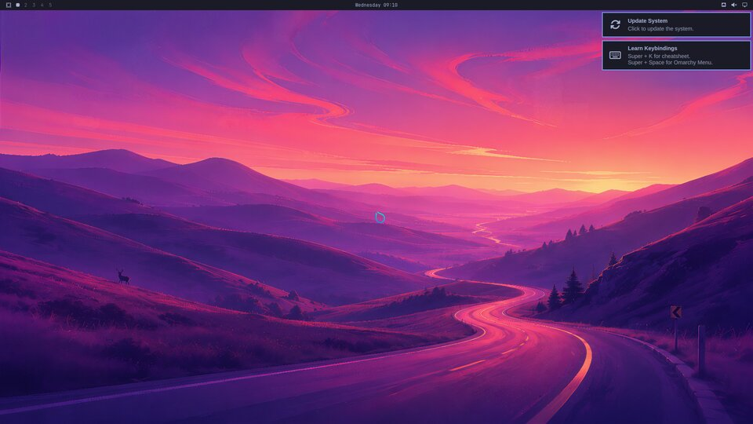
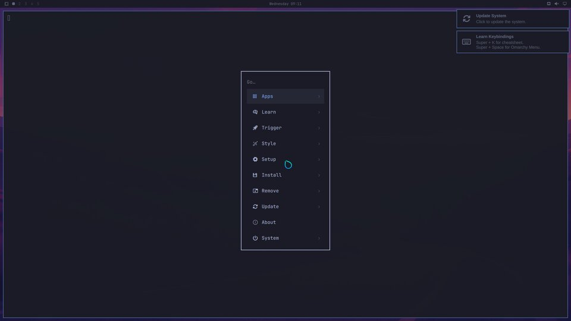

<p align="center"></p>

# OmniXY

[Omarchy](https://omarchy.org) on NixOS.

OmniXY packages upstream Omarchy (currently **v4.0.6**) for NixOS and replaces its
Arch-specific install scripts with a NixOS module. You get the real Omarchy
desktop: the Quickshell bar, menus, panels and lock screen, Hyprland's Lua config,
every bundled theme, and the `omarchy` CLI. Your system, though, is declared in a
flake and can be rolled back.

<p align="center">
  
  
</p>

## How it works

- **`pkgs.omarchy`** is upstream's repository, installed at
  `/run/current-system/sw/share/omarchy` (`$OMARCHY_PATH`). Its shebangs are patched
  and its `/usr/share/omarchy` paths are rewritten. Commands that only make sense on
  Arch (pacman, AUR, limine, snapper, the v3→v4 upgrade) become stubs that point to
  the NixOS way. The package helpers (`omarchy-pkg-add` and friends) install from
  nixpkgs into your nix profile. That means about 60 `omarchy-install-*` menu
  entries work without a rebuild, and anything that needs a system service prints
  the NixOS option to set instead.
- **`nixosModules.default`** covers what upstream's `omarchy-settings` package and
  `install/` scripts do: Hyprland + uwsm, SDDM with the Omarchy theme, PipeWire,
  NetworkManager/iwd, Bluetooth, CUPS, Docker, the firewall, fonts, Plymouth, zram,
  systemd-oomd, the lock-screen PAM services and Omarchy's user units.
- **No `/etc/skel` on NixOS**, so every login runs `omnixy-seed-user` first. It
  copies Omarchy's default user configs into `$HOME`, but only files that don't
  exist yet: your edits are never overwritten, and files that new releases add show
  up at your next login. Use `omarchy-reinstall-configs` to reset to the defaults.
- **Themes switch at runtime**, as upstream:
  <kbd>Super</kbd>+<kbd>Ctrl</kbd>+<kbd>Shift</kbd>+<kbd>Space</kbd> or
  `omarchy-theme-set "Catppuccin"`. No rebuild. `omnixy.theme` only sets the theme
  for your first login.

## Install

### From the ISO

Build the live ISO (`nix build github:TheArctesian/omnixy#iso`), write it to a USB
stick and boot it (UEFI). The desktop opens **Install OmniXY**, a guided installer
in the style of Omarchy's (relaunch it from the app launcher, or run
`omnixy-install`). It asks for keyboard, user name, password, full name, email,
hostname, timezone, the disk to erase and whether to encrypt it, then:

- partitions the disk with disko: a 1G EFI partition and btrfs (`@`, `@home`,
  `@nix`, `@log`, zstd compression), optionally inside LUKS2 unlocked with your
  password at boot (encrypted installs also log in automatically, as upstream);
- writes `/etc/nixos` as a flake importing `github:TheArctesian/omnixy`, with your
  answers in `configuration.nix` and the `nixos-generate-config` hardware file;
- runs `nixos-install` (needs internet) and offers to reboot.

`omnixy-install --dry-run` prints the generated files and the commands without
touching a disk; `--help` lists the `OMNIXY_INSTALL_*` variables that preset answers.

### Onto an existing NixOS

On an existing NixOS install (UEFI, flakes enabled):

```bash
cd /etc/nixos
sudo nix flake init -t github:TheArctesian/omnixy
# edit configuration.nix: set omnixy.user to your username, keep your
# hardware-configuration.nix
sudo nixos-rebuild switch --flake /etc/nixos#omnixy
```

Then reboot and pick **OmniXY** at the login screen. If you already have a flake,
add the input and the module:

```nix
inputs.omnixy.url = "github:TheArctesian/omnixy";
# ...
modules = [ omnixy.nixosModules.default ./configuration.nix ];
```

```nix
omnixy = {
  enable = true;
  user = "alice";
  fullName = "Alice Example";   # git identity + XCompose shortcut
  email = "alice@example.com";
  theme = "Tokyo Night";        # first-login theme
  # autoLogin = true;
  # preinstalls.enable = false; # skip LibreOffice, OBS, Kdenlive, Obsidian, ...
  # features = { docker = false; printing = false; plymouth = false; };
  # flake.path = "/home/alice/nixos";  # what omarchy-update rebuilds
};
```

### Try it first

Download the live ISO: **[iso.omnixy.org/latest](https://iso.omnixy.org/latest/omnixy-latest-x86_64-linux.iso)**.
Checksums and older versions are on the [releases page](https://github.com/TheArctesian/omnixy/releases).
It boots into the desktop as `omnixy` (password `omnixy`). Or build it yourself:

```bash
nix run github:TheArctesian/omnixy#vm   # throwaway VM, auto-logs in as omnixy/omnixy
nix build github:TheArctesian/omnixy#iso  # live ISO: the desktop plus the installer
```

## Day to day

| Omarchy | On OmniXY |
| --- | --- |
| `omarchy-update` | `nix flake update` + `nixos-rebuild switch` on `omnixy.flake.path`, then profile upgrades, mise, and restart prompts |
| Install › Package | searches nixpkgs and installs into your nix profile |
| Install › *App* | `nix profile add` (or prints the NixOS option for service-backed apps) |
| `omarchy-pkg-declarative` | prints your profile installs as an `environment.systemPackages` snippet to make them permanent |
| Snapshots (snapper/limine) | NixOS generations: pick an older one in the boot menu |
| Update › Channel | pin the `omnixy` input in your flake |

See [docs/differences.md](docs/differences.md) for everything that behaves differently
or is missing.

## Development

```bash
nix flake check                                   # evaluates hosts and runs the VM test
nix build .#checks.x86_64-linux.desktop -L        # just the desktop VM test (screenshots in result/)
nix run .#vm                                      # interactive VM
```

To move to a new Omarchy release, follow [docs/updating-upstream.md](docs/updating-upstream.md).
To publish an ISO, see [docs/releasing.md](docs/releasing.md).

## Layout

```
flake.nix                  inputs (nixpkgs, omarchy@tag), outputs
packages/omarchy/          the Omarchy package + NixOS replacement commands (bin/)
packages/*.nix             ttfx, tensaku, fonts, sddm and plymouth themes
packages/omnixy-install/   the ISO's guided installer
modules/                   the NixOS module (options in default.nix)
hosts/{example,vm,iso}/    example machine, test VM, live ISO
templates/default/         `nix flake init -t` starter
tests/desktop.nix          boots the desktop and screenshots it
tests/installer.nix        shellchecks omnixy-install and checks its --dry-run output
```

## License

MIT, like Omarchy. Omarchy is © David Heinemeier Hansson and contributors. OmniXY is
an unofficial community port.
